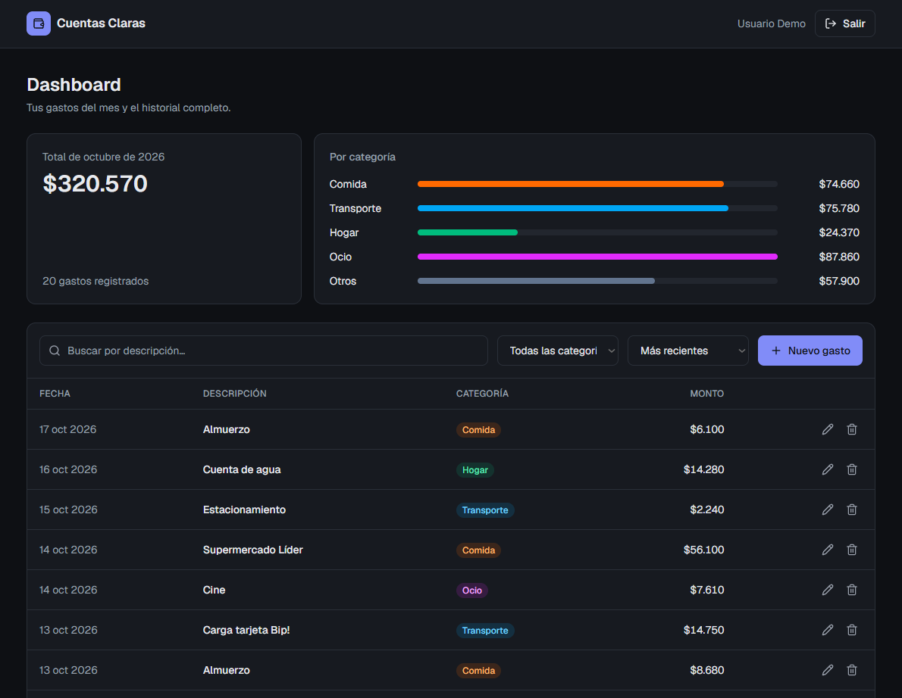

# Cuentas Claras — Next.js + Django API

[](https://github.com/y-jeff/Cuentas-Claras/actions/workflows/ci.yml)

> *Cuentas claras conservan la amistad.* Un proyecto de [3rlabs](https://3rlabs.cl).

Registro de gastos del hogar con **arquitectura desacoplada**: un frontend en **Next.js 16 + TypeScript** que consume una **API REST en Django Ninja**, conectados por un contrato OpenAPI tipado de punta a punta.

| | |
|---|---|
| **App** | https://cuentasclaras.3rlabs.cl — botón **"Entrar como demo"** |
| **API docs (Swagger)** | https://api-cuentasclaras.3rlabs.cl/api/docs |
| **Cuenta demo** | `demo` / `demo1234` |



## Qué demuestra este proyecto

- **API REST documentada** con OpenAPI/Swagger generado automáticamente (`/api/docs`).
- **Autenticación por sesión en cookie HttpOnly** + protección **CSRF** (nada de tokens en `localStorage`).
- **Paginación, filtros, búsqueda y orden en el servidor**: `GET /api/gastos?page=2&categoria=transporte&search=uber&orden=-monto`.
- **Errores HTTP semánticos** en un formato único: `400` con errores por campo, `401` sesión expirada, `403` CSRF, `404`, `500` controlado.
- **Contrato tipado**: los tipos TypeScript se **generan** desde el OpenAPI de Django, y el CI falla si el contrato commiteado queda desactualizado.
- **Formulario con React Hook Form + Zod**: los errores 400 de Django se muestran bajo cada input.
- **Estados asíncronos visibles**: skeletons, estado vacío, toasts ante fallas de red y **eliminación optimista** con rollback.
- **Búsqueda en vivo con debounce** y paginación sin parpadeos (`keepPreviousData`).
- **Tests** con pytest sobre Postgres real y **CI en GitHub Actions** (backend, frontend y contrato).
- **`docker compose up`** levanta Postgres + API + frontend con datos de prueba.
- **En producción con costo $0**: frontend en Vercel y API en un servidor propio detrás de un túnel de Cloudflare, sin puertos abiertos.
- **Deploy continuo**: Vercel publica cada push, y el servidor se actualiza solo cuando el CI termina en verde ([`scripts/actualizar-servidor.sh`](scripts/actualizar-servidor.sh)).

## Arquitectura

```
 Navegador
    │  https://cuentasclaras.3rlabs.cl
    ▼
 Next.js en Vercel ── /login, /dashboard (React)
    │  /api/*  (rewrite → proxy)
    ▼
 Cloudflare ── https://api-cuentasclaras.3rlabs.cl
    │  túnel (cloudflared), sin puertos abiertos
    ▼
 Servidor 3R Labs ── Docker: Django Ninja + Gunicorn ──► SQLite (./data/db.sqlite3)
```

El navegador **solo habla con el dominio del frontend**. Next reenvía `/api/*` a Django mediante `rewrites`, así que la cookie de sesión es *first-party*: puede ser `HttpOnly` + `SameSite=Lax` sin configurar CORS ni cookies de terceros, que los navegadores bloquean cada vez más.

La API se publica con un **túnel de Cloudflare**: el servidor no abre puertos a internet y el contenedor solo escucha en `127.0.0.1`. En producción usa SQLite (un archivo, respaldo trivial, unos 100 MB de RAM); en local y en el CI, PostgreSQL.

**Flujo de autenticación**

1. `POST /api/auth/login`: Django valida las credenciales y crea la sesión (`sessionid`, HttpOnly).
2. Django rota el token CSRF y envía la cookie `csrftoken` (legible por JS).
3. Cada `POST/PUT/DELETE` envía el header `X-CSRFToken`. Sin él, Django responde `403`.
4. Si la sesión expira, cualquier `401` redirige a `/login` y se limpia la caché del cliente.

## Stack

| Capa | Tecnologías |
|---|---|
| Frontend | Next.js 16 (App Router), React 19, TypeScript estricto, Tailwind CSS 4, TanStack Query, React Hook Form, Zod, Sonner |
| Backend | Django 5.2 LTS, Django Ninja (Pydantic), Gunicorn, WhiteNoise, SQLite (producción) / PostgreSQL (local y CI) |
| Contrato | OpenAPI 3 → `openapi-typescript` |
| Calidad | pytest + pytest-django, ESLint, `tsc`, GitHub Actions |
| Infra | Docker, docker compose, Vercel (frontend), servidor propio + túnel de Cloudflare (API), cron de actualización y respaldo |

## Probarlo en local

### Opción A — Docker (un comando)

```bash
docker compose up --build
```

- Frontend: http://localhost:3000 (entra con **"Entrar como demo"**)
- Swagger: http://localhost:8000/api/docs

### Opción B — Sin Docker

```bash
# Backend (usa SQLite si no defines DATABASE_URL)
cd backend
python -m venv .venv && source .venv/bin/activate   # Windows: .venv\Scripts\activate
pip install -r requirements.txt
cp .env.example .env
python manage.py migrate
python manage.py seed          # crea demo/demo1234 con 80 gastos
python manage.py runserver

# Frontend (otra terminal)
cd frontend
npm install
npm run dev                    # http://localhost:3000
```

## API

| Método | Ruta | Descripción |
|---|---|---|
| `POST` | `/api/auth/login` | Inicia sesión |
| `POST` | `/api/auth/logout` | Cierra sesión |
| `GET` | `/api/auth/me` | Usuario actual |
| `GET` | `/api/gastos` | Lista paginada. Query: `page`, `page_size`, `categoria`, `search`, `orden` |
| `POST` | `/api/gastos` | Crea un gasto |
| `GET` / `PUT` / `DELETE` | `/api/gastos/{id}` | Detalle, edición y eliminación |
| `GET` | `/api/gastos/resumen` | Totales del mes por categoría |

Todas las respuestas de error comparten la forma:

```json
{
  "detail": "Revisa los datos enviados.",
  "errors": {
    "monto": ["El monto debe ser mayor a 0."],
    "fecha": ["La fecha no puede ser futura."]
  }
}
```

> Para ver el mapeo de errores en la UI, crea un gasto con una **fecha futura**: esa regla vive solo en Django, y su error aparece bajo el input de fecha.

## Contrato tipado

```bash
# 1. Exportar el esquema desde Django
cd backend
python manage.py export_openapi_schema --api config.api.api --output openapi.json --indent 2

# 2. Regenerar los tipos TypeScript
cd ../frontend
npm run generate:types         # → src/lib/api-types.ts
```

Si cambia un schema en Django y no se regeneran los tipos, el job **"Contrato API ↔ tipos TS"** del CI falla. Si cambia el contrato y el frontend no se adapta, falla `tsc`.

## Tests

```bash
cd backend && pytest                                         # 16 tests: auth, CSRF, paginación, filtros, validaciones, permisos, resumen
cd frontend && npm run lint && npm run typecheck && npm run build
```

## Producción (3R Labs)

Modelo híbrido, sin costo: el frontend en **Vercel** y la API en el **servidor de 3R Labs**. La API corre en un solo contenedor con SQLite ([`docker-compose.prod.yml`](docker-compose.prod.yml)), con un límite de 256 MB de RAM.

| Pieza | Dónde | Dominio |
|---|---|---|
| Frontend | Vercel (Hobby), root `frontend`, `BACKEND_URL=https://api-cuentasclaras.3rlabs.cl` | [cuentasclaras.3rlabs.cl](https://cuentasclaras.3rlabs.cl) |
| API + SQLite | Servidor 3R Labs: Docker + túnel de Cloudflare | [api-cuentasclaras.3rlabs.cl](https://api-cuentasclaras.3rlabs.cl/api/docs) |

| DNS (Cloudflare, zona `3rlabs.cl`) | Tipo | Destino | Proxy |
|---|---|---|---|
| `cuentasclaras` | CNAME | el valor que indica Vercel (`*.vercel-dns-017.com`) | DNS only |
| `api-cuentasclaras` | Tunnel | túnel de cloudflared del servidor | Proxied |

**Cómo se actualiza**
- **Frontend:** Vercel despliega cada push a `main`.
- **API:** un cron en el servidor ejecuta [`scripts/actualizar-servidor.sh`](scripts/actualizar-servidor.sh) cada 5 minutos. Si hay commits nuevos con **CI en verde**, trae los cambios y reconstruye el contenedor solo si cambió `backend/` o `docker-compose.prod.yml`.
- **Respaldo:** copia diaria de SQLite en `data/backups/` (se guardan 14 días).

Guía completa (instalación, túnel, DNS, pruebas, respaldos y problemas comunes): [docs/DEPLOY-3RLABS.md](docs/DEPLOY-3RLABS.md).

## Uso real (cuentas de la familia)

No hay registro abierto: las cuentas se crean desde el admin de Django. Cada usuario ve **solo sus propios gastos**.

```bash
# En el servidor, dentro de /opt/cuentas-claras
docker compose -f docker-compose.prod.yml exec api python manage.py createsuperuser
```

Luego entra a `https://api-cuentasclaras.3rlabs.cl/admin/` y crea el resto de los usuarios en *Users → Add*. Cada uno inicia sesión en `cuentasclaras.3rlabs.cl` con su usuario y contraseña.

## Estructura

```
├── backend/
│   ├── config/            # settings, urls, NinjaAPI y manejo global de errores
│   └── gastos/
│       ├── models.py      # Gasto + Categoria
│       ├── schemas.py     # contrato de entrada/salida y validaciones
│       ├── api.py         # CRUD, listado paginado y resumen
│       ├── auth_api.py    # login, logout, me
│       ├── management/commands/seed.py
│       └── tests/
├── frontend/
│   └── src/
│       ├── app/           # /login, /dashboard, providers
│       ├── components/    # tabla, formulario, modales, resumen
│       ├── hooks/         # TanStack Query (queries, mutaciones optimistas), debounce
│       ├── lib/           # cliente API, tipos generados, schemas Zod
│       └── proxy.ts       # redirige a /login si no hay cookie de sesión
├── docs/
│   ├── DEPLOY-3RLABS.md   # guía de producción en 3R Labs
│   └── screenshot.png
├── scripts/
│   └── actualizar-servidor.sh   # cron: actualiza la API cuando el CI pasa
├── docker-compose.yml           # local: Postgres + API + frontend
├── docker-compose.prod.yml      # producción: solo la API, con SQLite
├── .env.prod.example
└── .github/workflows/ci.yml
```
